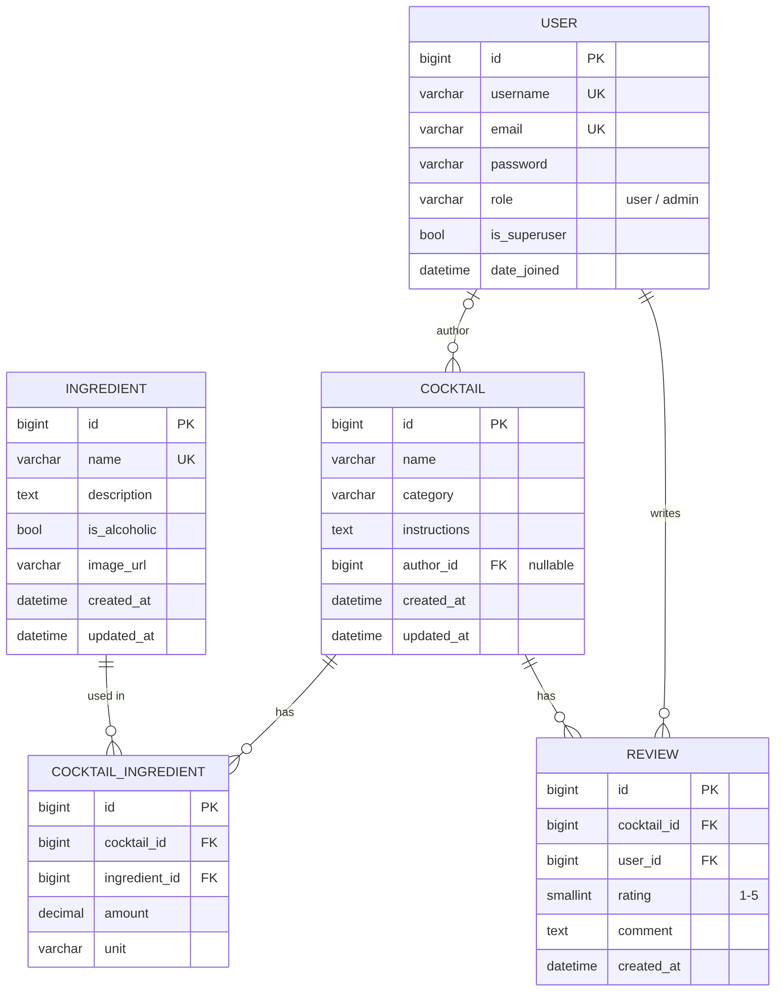

# Cocktails API

REST API do zarządzania koktajlami i składnikami. Zrobione w Django + Django REST Framework, baza PostgreSQL.

Co jest zrobione:
- CRUD koktajli i składników
- rejestracja i logowanie (JWT), role `user` i `admin`
- koktajl może edytować / usuwać tylko autor albo admin
- oceny (1-5) z recenzją
- paginacja, filtrowanie, sortowanie i wyszukiwanie
- walidacja danych (też w filtrach)
- dokumentacja Swagger
- testy (42 testy)

## Jak uruchomić

Potrzebny jest Python 3.12+ i Docker.

```bash
python -m venv .venv
.venv\Scripts\activate            # na Linux / Mac: source .venv/bin/activate
pip install -r requirements.txt

copy .env.example .env            # na Linux / Mac: cp .env.example .env
docker compose up -d              # baza PostgreSQL

python manage.py migrate
python manage.py createsuperuser
python manage.py seed             # przykładowe koktajle i składniki
python manage.py runserver
```

Potem:
- Swagger: http://127.0.0.1:8000/api/docs/
- API: http://127.0.0.1:8000/api/
- panel admina: http://127.0.0.1:8000/admin/

Żeby w Swaggerze testować endpointy wymagające logowania: zaloguj się przez `/api/auth/login/`, skopiuj `access` token, kliknij **Authorize** i wklej go.

## Testy

```bash
python manage.py test
```

Testy potrzebują działającej bazy z Dockera (Django samo tworzy i usuwa testową bazę).

## Baza danych



- `Ingredient` - składnik (nazwa, opis, czy alkoholowy, link do zdjęcia)
- `Cocktail` - koktajl (nazwa, kategoria, instrukcja, autor)
- `CocktailIngredient` - tabela pośrednia między koktajlem a składnikiem, trzyma ilość i jednostkę
- `Review` - ocena 1-5 i komentarz, jeden użytkownik może ocenić koktajl tylko raz
- `User` - własny model użytkownika z polem `role` (`user` albo `admin`)

Składnika, który jest użyty w jakimś koktajlu, nie da się usunąć (API zwraca `409`). Jak usunie się użytkownika, jego koktajle zostają, tylko bez autora.

## Logowanie (JWT)

| Metoda | URL | Opis |
|---|---|---|
| POST | `/api/auth/register/` | rejestracja (`username`, `email`, `password`) |
| POST | `/api/auth/login/` | logowanie, zwraca `access` i `refresh` token |
| POST | `/api/auth/refresh/` | nowy `access` token |
| GET | `/api/auth/me/` | dane zalogowanego użytkownika |

Token trzeba wysyłać w nagłówku: `Authorization: Bearer <access_token>`

Nowy użytkownik zawsze ma rolę `user`. Admina można zrobić przez `createsuperuser` albo zmienić rolę w panelu admina.

## Koktajle i składniki

| Metoda | URL | Kto może |
|---|---|---|
| GET | `/api/cocktails/` | wszyscy |
| POST | `/api/cocktails/` | zalogowany |
| GET | `/api/cocktails/{id}/` | wszyscy |
| PUT / PATCH / DELETE | `/api/cocktails/{id}/` | autor albo admin |
| GET | `/api/cocktails/{id}/reviews/` | wszyscy |
| POST | `/api/cocktails/{id}/reviews/` | zalogowany |
| GET | `/api/ingredients/`, `/api/ingredients/{id}/` | wszyscy |
| POST | `/api/ingredients/` | zalogowany |
| PUT / PATCH / DELETE | `/api/ingredients/{id}/` | admin |

Przykład dodania koktajlu:

```json
POST /api/cocktails/
{
  "name": "Virgin Mojito",
  "category": "highball",
  "instructions": "Muddle mint with syrup and lime, top with soda.",
  "ingredients": [
    {"ingredient_id": 7, "amount": 8, "unit": "leaf"},
    {"ingredient_id": 5, "amount": 25, "unit": "ml"}
  ]
}
```

Przy PATCH można nie wysyłać `ingredients`, wtedy składniki zostają takie same.

Przykład oceny:

```json
POST /api/cocktails/1/reviews/
{"rating": 5, "comment": "Very good"}
```

## Filtrowanie, sortowanie, paginacja

- `?page=2&page_size=20` (max 100 na stronę)
- `?alcoholic=false&ingredient=mint` - bezalkoholowe koktajle z miętą
- `?ingredient=lime,vodka` - koktajle, które mają wszystkie podane składniki
- `?category=sour`, `?name=moj`, `?author=2`
- `?search=rum` - szuka w nazwie i instrukcji
- `?ordering=name`, `?ordering=-created_at`, `?ordering=-avg_rating`

Składniki: `?name=`, `?is_alcoholic=true/false`, `?search=`, `?ordering=`

Przy złych wartościach filtrów (np. `?alcoholic=abc`) API zwraca `400`.
